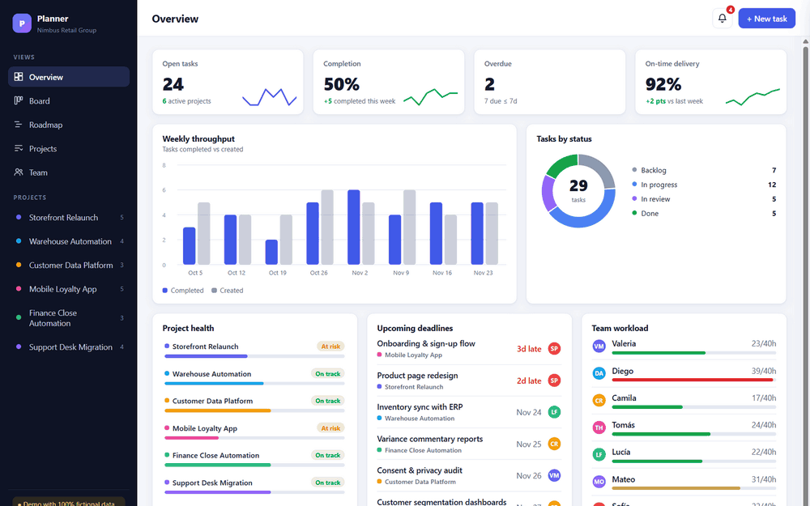
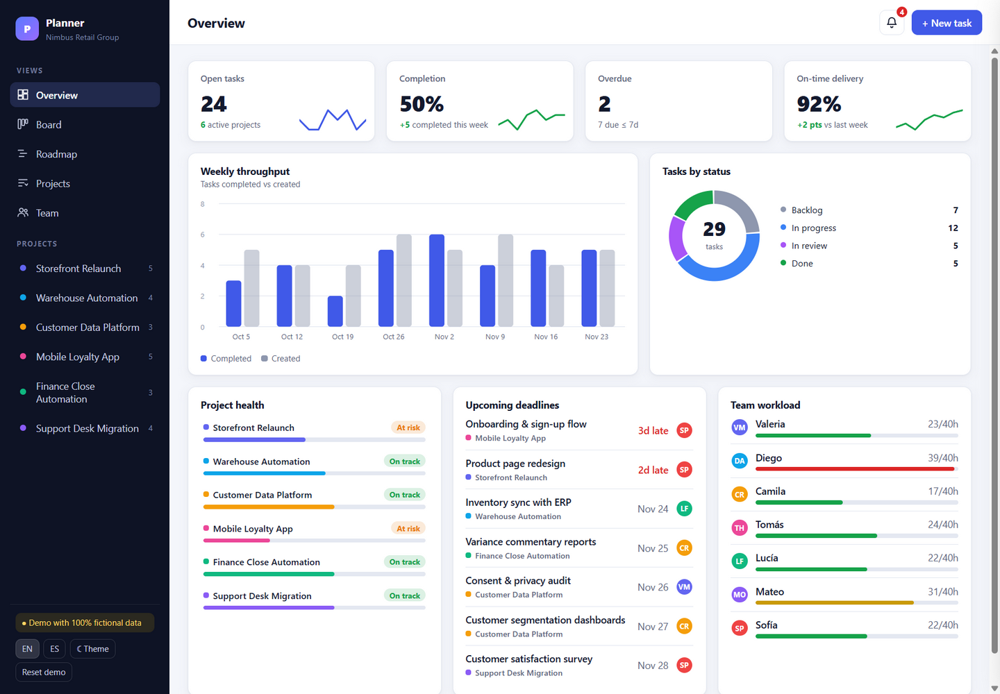
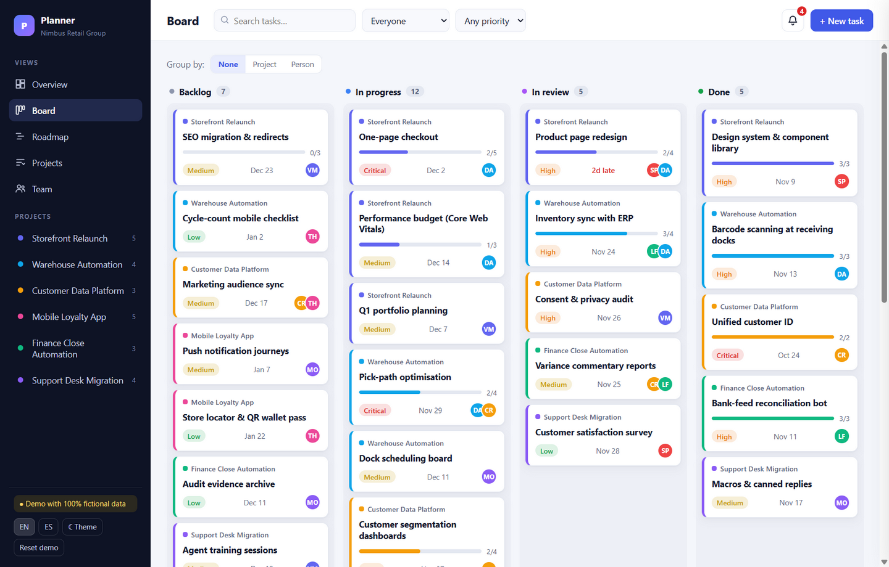
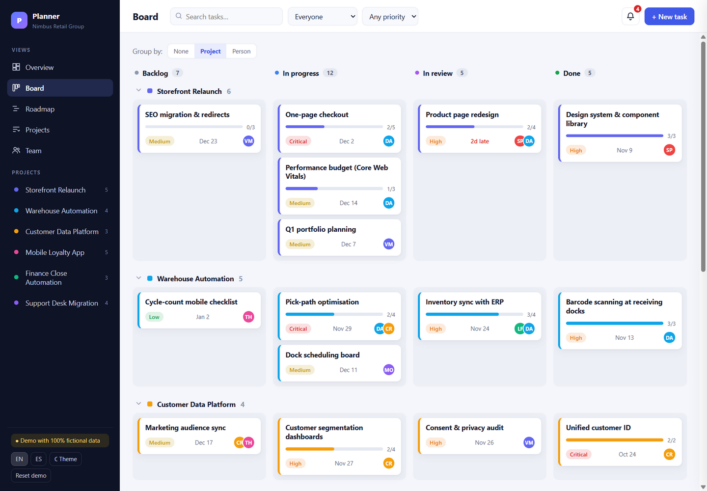
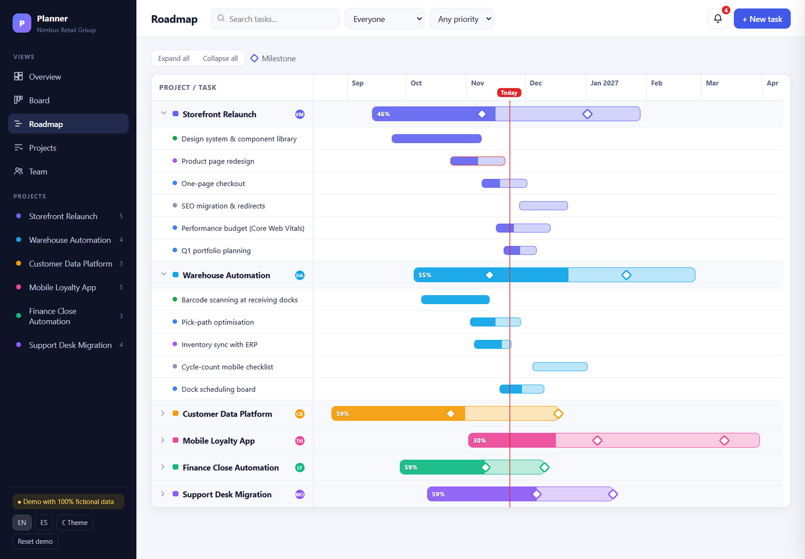
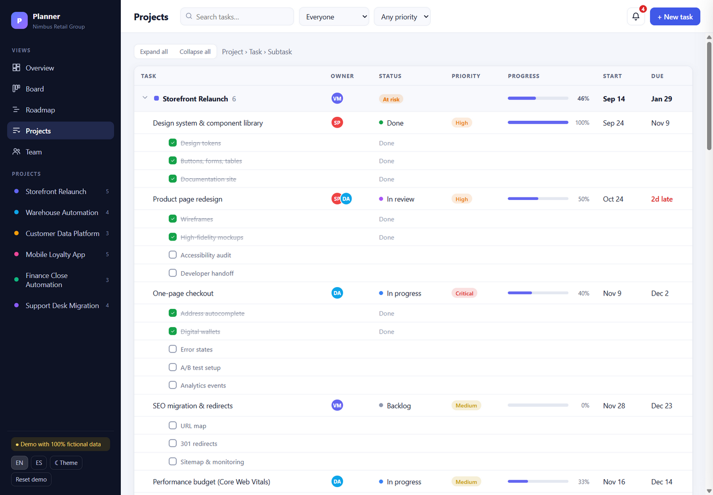
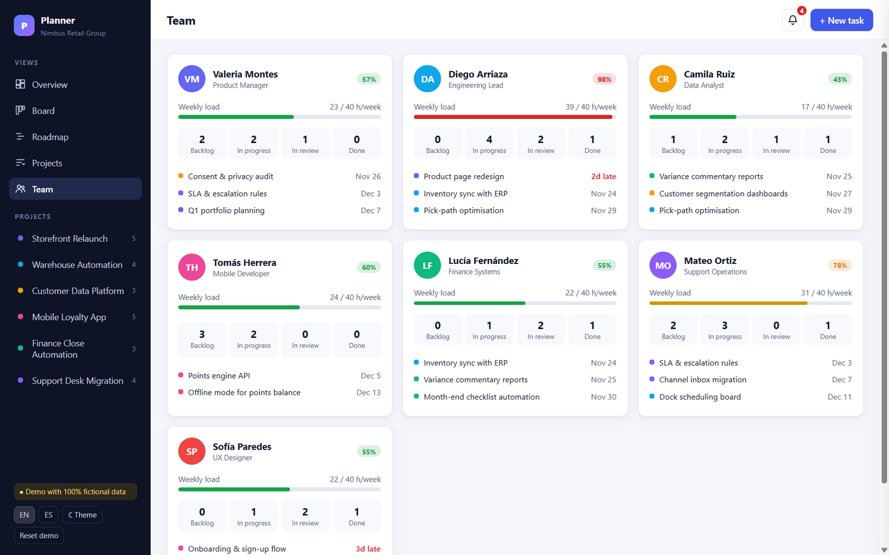
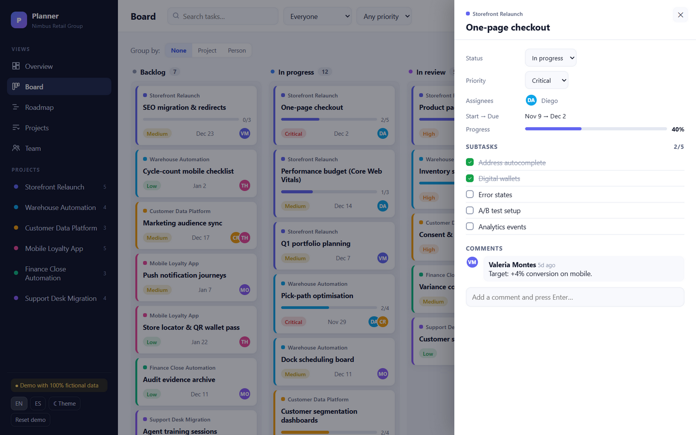
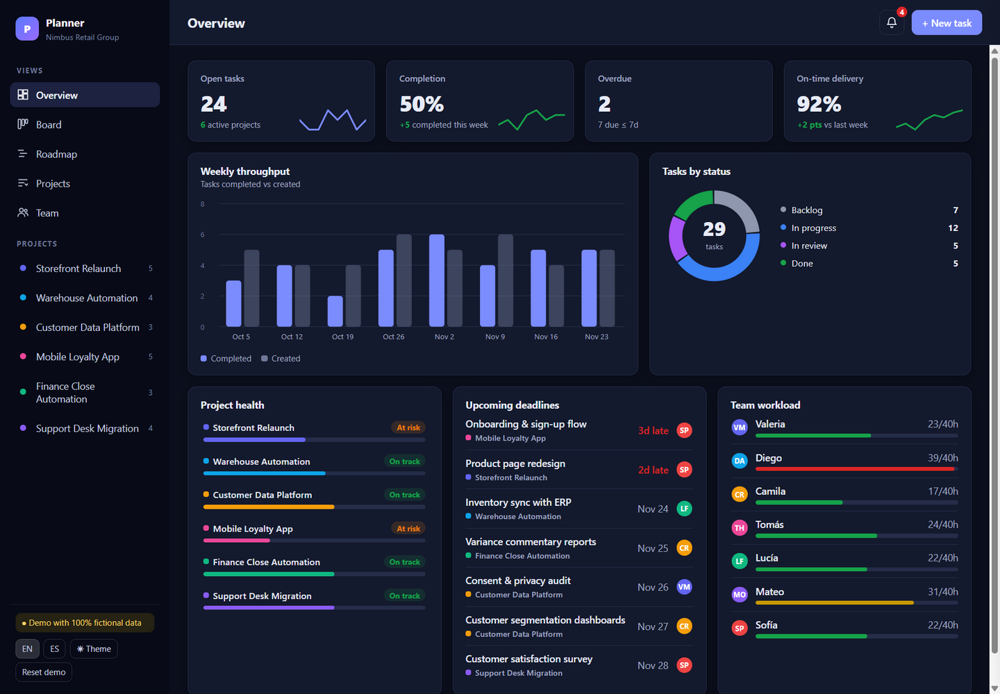
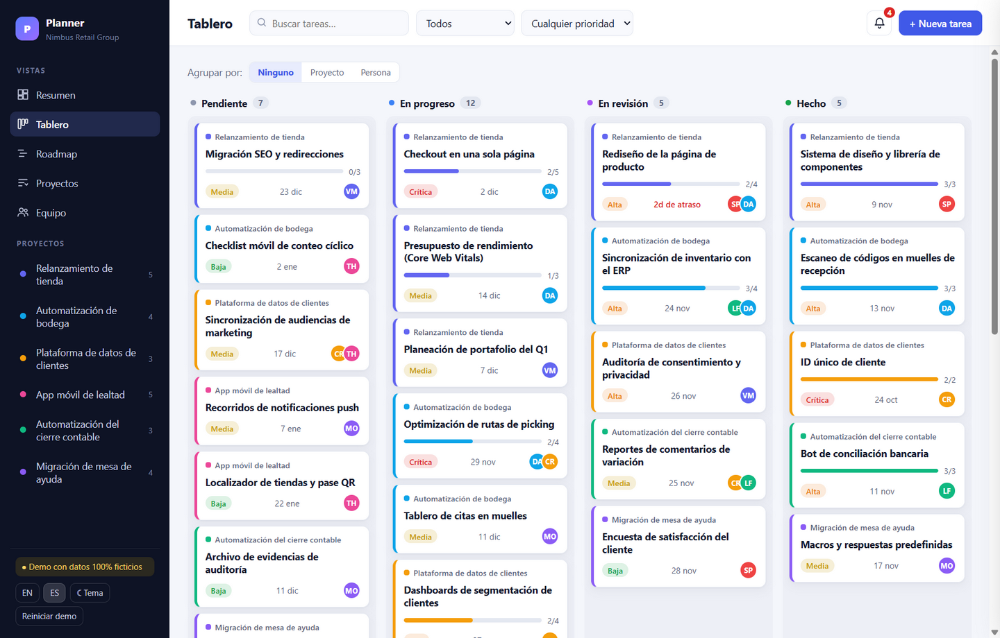

# Planner — espacio de proyectos y equipo (demo interactiva)

> [Read in English](README.md)



**Planner** es un espacio ligero de gestión de proyectos: tablero, roadmap, jerarquía, carga del equipo y métricas de entrega en un solo lugar, sin licencias por usuario.

Este repositorio es una **demo estática y autocontenida** (HTML/CSS/JS puro, sin compilación, sin servidor, sin dependencias). **Todos los datos son ficticios**: la empresa, las personas, los proyectos y las cifras están inventados.

▶ **Demo en vivo:** https://rodrigosoria07.github.io/planner-demo/ — o abre `index.html` en cualquier navegador (o sirve la carpeta con `python -m http.server`).

---

## El problema

Los equipos en crecimiento terminan pagando licencias por usuario de herramientas comerciales de gestión de proyectos y, aun así, siguen llevando media operación en hojas de cálculo porque la herramienta es demasiado pesada, rígida o cara para darla a todos. Resultado: datos dispersos, ningún lugar donde ver quién está sobrecargado y gerentes que arman a mano los reportes de avance.

## La solución

Un solo espacio que responde lo que los gerentes realmente preguntan:

| Pregunta | Vista |
|---|---|
| ¿En qué estado está cada proyecto hoy? | **Resumen** — KPIs, productividad, estados, salud de proyectos |
| ¿Qué avanza y qué está bloqueado? | **Tablero** — Kanban con arrastrar y soltar, agrupado por proyecto o persona |
| ¿Qué sale y cuándo? | **Roadmap** — línea de tiempo con avance, hitos y marcador de *hoy* |
| ¿Cómo está estructurado el trabajo? | **Proyectos** — jerarquía *Proyecto › Tarea › Subtarea* en columnas |
| ¿Quién está sobrecargado? | **Equipo** — carga semanal vs capacidad, trabajo abierto por persona |

## Qué reemplazó

La versión de producción de esta idea (Google Sheets + Apps Script, construida y operada por mí para un equipo de TI) **reemplazó licencias por usuario de herramientas comerciales de gestión de proyectos**: los datos viven en una hoja de cálculo que la empresa ya posee, los permisos se validan en el servidor y las notificaciones usan las herramientas que la gente ya utiliza. Esta demo pública recrea la *experiencia* con datos inventados; no contiene código ni datos de ese sistema.

## Capturas

| Resumen | Tablero |
|---|---|
|  |  |
| **Tablero agrupado por proyecto** | **Roadmap** |
|  |  |
| **Proyecto › Tarea › Subtarea** | **Carga del equipo** |
|  |  |
| **Detalle de tarea** | **Modo oscuro** |
|  |  |
| **Interfaz en español (selector EN/ES)** | |
|  | |

## Funciones

- Arrastrar y soltar entre *Pendiente → En progreso → En revisión → Hecho*; métricas, avance y salud se actualizan al instante.
- Carriles: agrupa el tablero por proyecto o por persona (se pueden contraer).
- Roadmap con barras de proyecto, hitos, barras por tarea (atrasos resaltados) y expandir/contraer.
- Tabla jerárquica con subtareas marcables que suben el avance a la tarea y al proyecto.
- Panel de tarea: estado, prioridad, asignados, fechas, subtareas y comentarios.
- Vista de equipo con carga vs capacidad (verde / ámbar / rojo).
- Búsqueda y filtros (proyecto, persona, prioridad), formulario de nueva tarea, panel de notificaciones.
- Interfaz en inglés y español, tema claro y oscuro. El estado se guarda en `localStorage` (**Reiniciar demo** restaura los datos).
- Teclado: `Esc` cierra los paneles. Adaptable hasta ancho de tableta.

## Tecnología

JavaScript puro (sin framework), variables CSS y gráficos SVG en línea. Unas 1.000 líneas en total: fácil de leer y de alojar en cualquier lugar (GitHub Pages, Netlify, un bucket S3).

```
index.html
css/styles.css
js/data.js     # datos ficticios + textos i18n
js/app.js      # estado, tablero, panel, rutas
js/views.js    # resumen, roadmap, jerarquía, equipo
```

Enlaces directos para demostraciones: `index.html?lang=es&theme=dark&group=project#board`.

## Ideas de evolución

Consulta [docs/commercial-improvements.md](docs/commercial-improvements.md) para ver el razonamiento de producto detrás de esta versión.

## Acerca de

Construido por **Rodrigo Soria** — Coordinador de IT. [LinkedIn](https://www.linkedin.com/in/rodrigosoria097)

Licencia MIT. Datos ficticios; cualquier parecido con empresas o personas reales es coincidencia.
