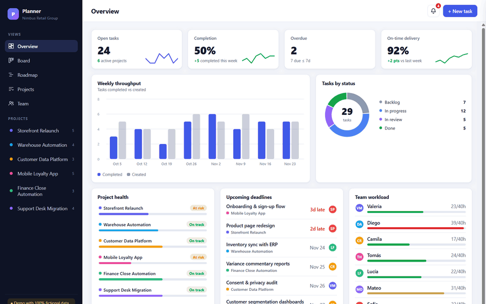
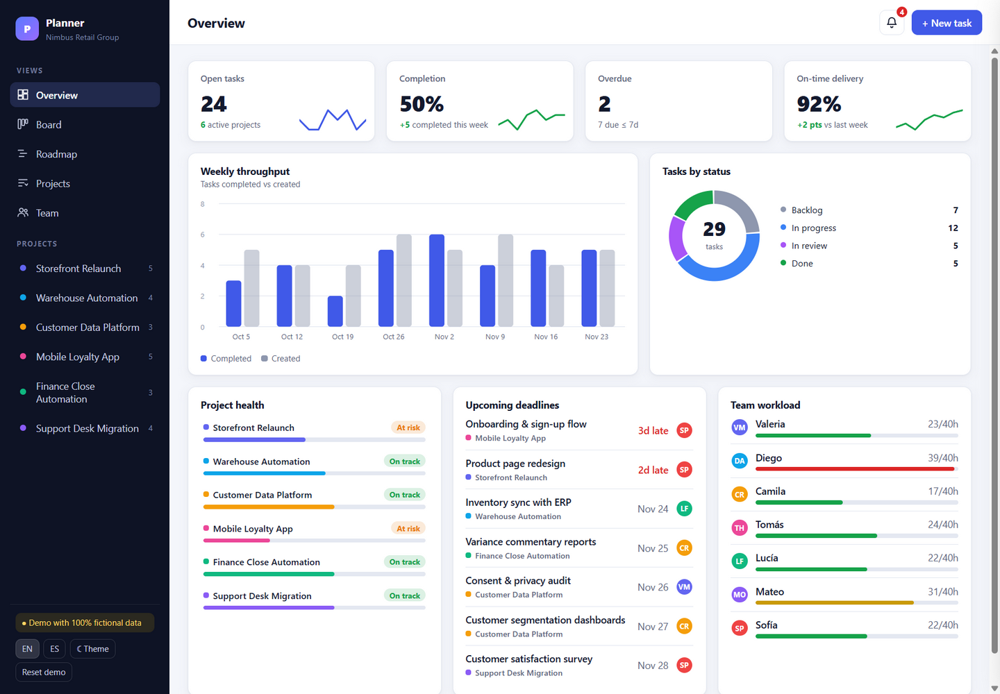
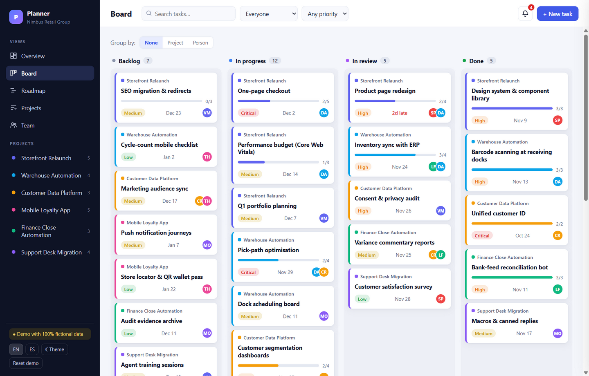
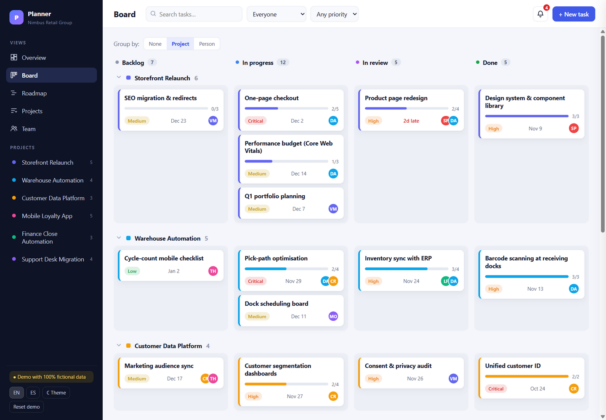
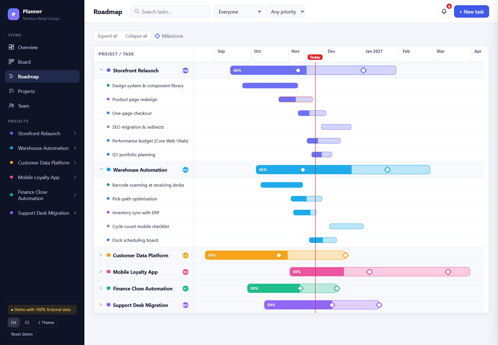
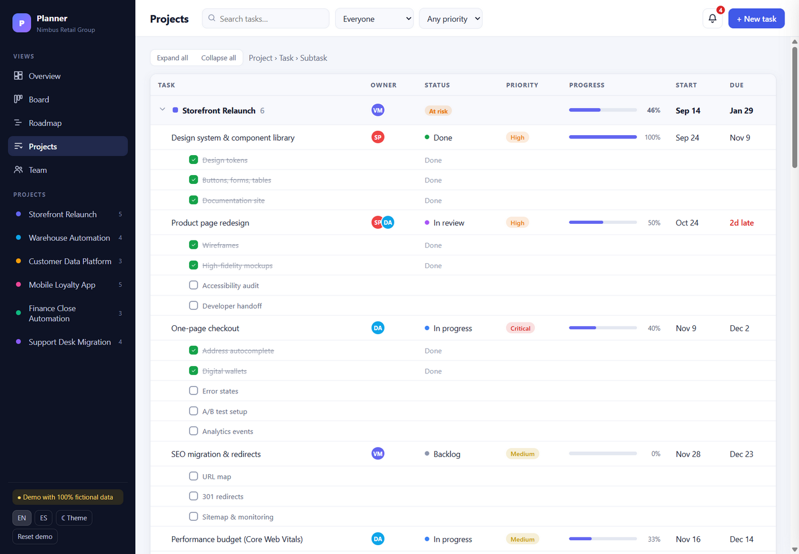
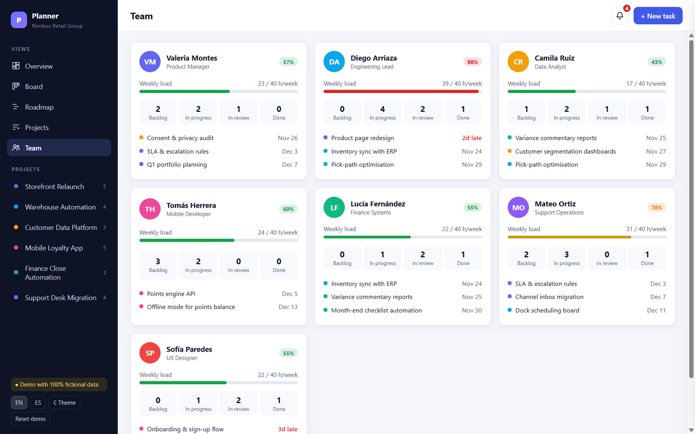
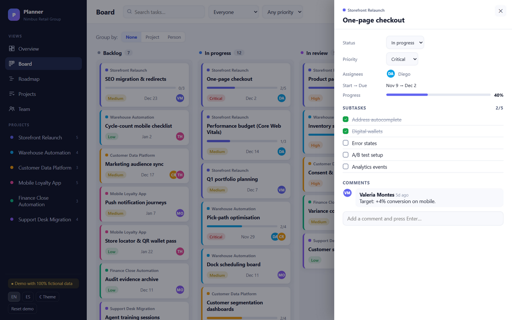
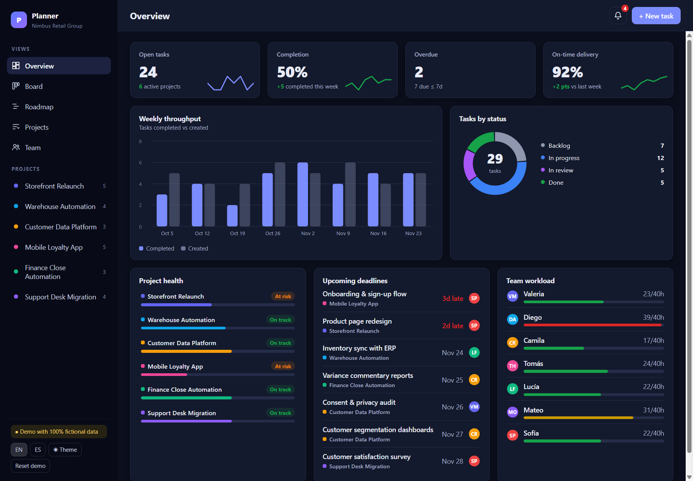
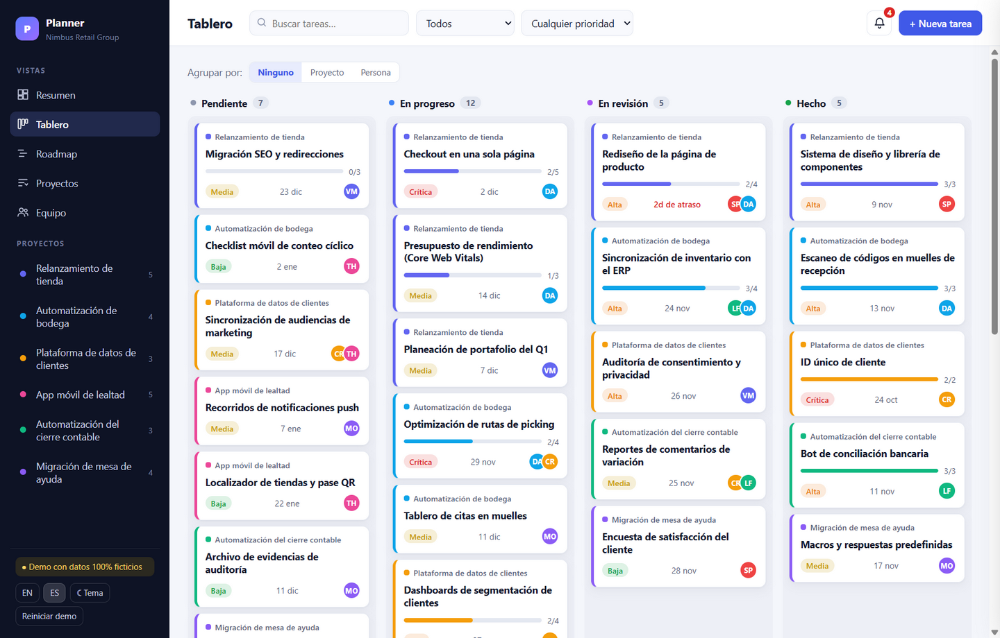

# Planner — project & team workspace (interactive demo)

> [Leer en español](README.es.md)



**Planner** is a lightweight project-management workspace: board, roadmap, hierarchy, team workload and delivery metrics in one place — without per-seat licences.

This repository is a **self-contained, static demo** (plain HTML/CSS/JS, no build step, no server, no dependencies). **All data is fictional**: the company, people, projects and numbers are invented for demonstration.

▶ **Live demo:** https://rodrigosoria07.github.io/planner-demo/ — or open `index.html` in any browser (or serve the folder with `python -m http.server`).

---

## The problem

Growing teams end up paying per-user licences for tools such as **Jira** or **monday.dev**, then still run half their work from spreadsheets because the tool is too heavy, too rigid or too expensive to give to everyone. The result: scattered data, no single view of who is overloaded, and managers who rebuild status reports by hand.

## The solution

One workspace that answers the questions managers actually ask:

| Question | View |
|---|---|
| What is the state of every project right now? | **Overview** — KPIs, throughput, status split, project health |
| What is moving, what is blocked? | **Board** — Kanban with drag & drop, grouped by project or person |
| What ships when? | **Roadmap** — timeline with progress, milestones and a *today* marker |
| How is the work structured? | **Projects** — *Project › Task › Subtask* hierarchy in columns |
| Who is overloaded? | **Team** — weekly load vs capacity, open work per person |

## What it replaced

The production version of this idea (Google Sheets + Apps Script, built and run by me for an IT team) **replaced Jira and monday.dev licences**: the data stays in a spreadsheet the company already owns, permissions are enforced server-side, and notifications go through the tools people already use. This public demo recreates the *experience* with invented data — it does not contain any code or data from that system.

## Screenshots

| Overview | Board |
|---|---|
|  |  |
| **Board grouped by project** | **Roadmap** |
|  |  |
| **Project › Task › Subtask** | **Team workload** |
|  |  |
| **Task detail** | **Dark mode** |
|  |  |
| **Spanish UI (EN/ES toggle)** | |
|  | |

## Features

- Drag & drop between *Backlog → In progress → In review → Done*; metrics, progress and health update live.
- Swimlanes: group the board by project or by person (collapsible).
- Roadmap with project bars, milestones, per-task bars (overdue highlighted) and expand/collapse.
- Hierarchy table with tickable subtasks that roll progress up to task and project.
- Task drawer: status, priority, assignees, dates, subtasks and comments.
- Team view with workload vs. capacity (green / amber / red).
- Search + filters (project, person, priority), new-task form, notifications panel.
- English / Spanish UI, light / dark theme. State is kept in `localStorage` (**Reset demo** restores the data).
- Keyboard: `Esc` closes panels. Responsive down to tablet width.

## Tech

Vanilla JavaScript (no framework), CSS custom properties, inline SVG charts. About 1,000 lines in total — easy to read and to host anywhere (GitHub Pages, Netlify, an S3 bucket).

```
index.html
css/styles.css
js/data.js     # fictional dataset + i18n strings
js/app.js      # state, board, drawer, routing
js/views.js    # overview, roadmap, hierarchy, team
```

Deep links for demos: `index.html?lang=es&theme=dark&group=project#board`.

## Product thinking

See [docs/commercial-improvements.md](docs/commercial-improvements.md) for the commercial reasoning behind this version and suggested next steps.

## About

Built by **Rodrigo Soria** — IT Coordinator. [LinkedIn](https://www.linkedin.com/in/rodrigosoria097)

Licensed under MIT. Fictional data; any resemblance to real companies or people is coincidental.
